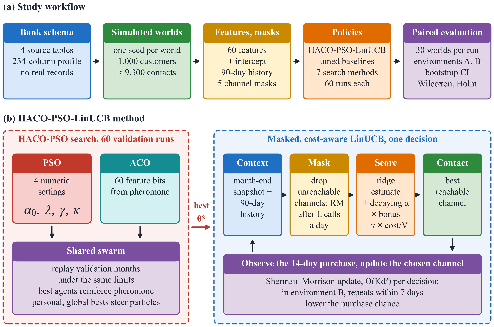
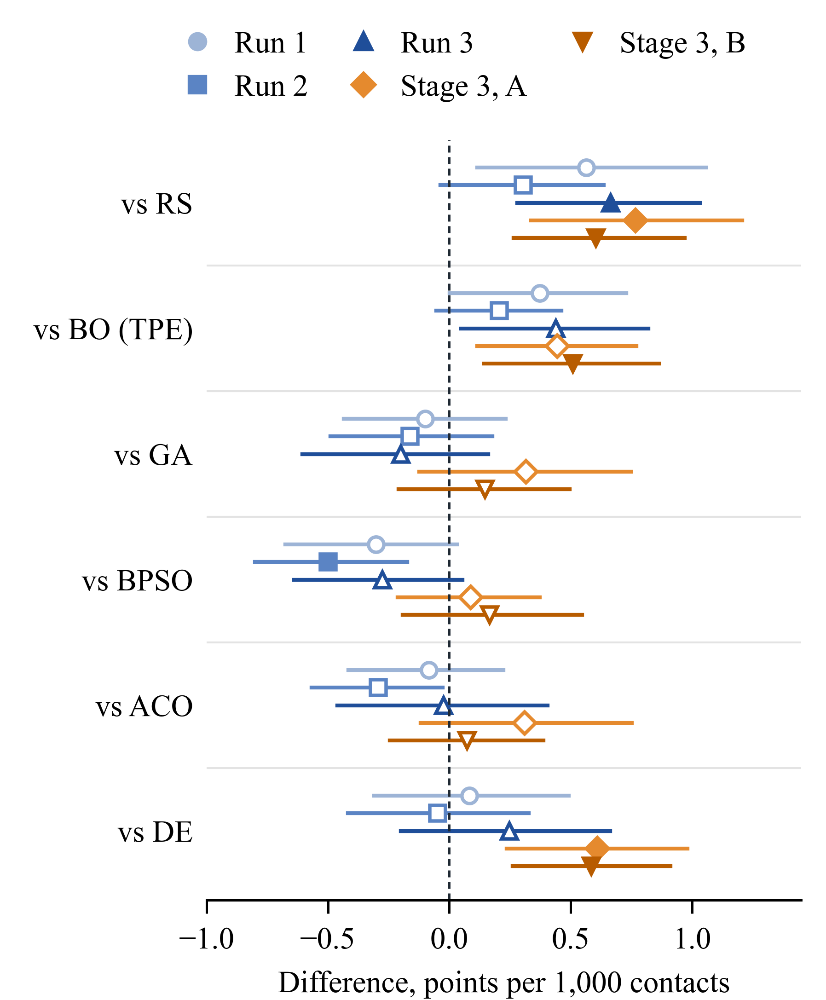
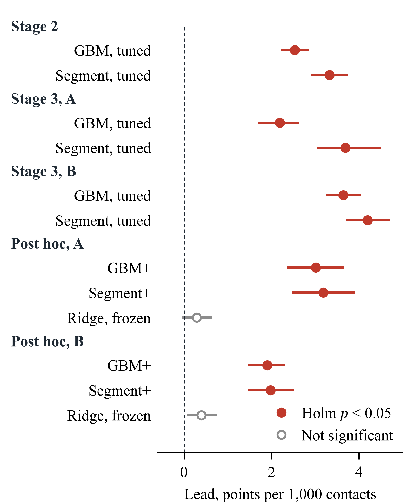

# HACO-PSO-LinUCB: results, tables and run logs

Supporting results for the manuscript **"Enhanced Masked Contextual Bandits for Bank Channel Selection: An Empirical Comparison of a Dual-Model Hybrid with Conventional Metaheuristics"**.

V. V. Chau, U. Klinsak, and P. Meesad

This repository holds the numbers behind every table and figure in the manuscript: per-world JSON logs, the computed summary tables and the figures. Source code is not included; it is available from the corresponding author, as stated in the manuscript.

## Summary of the study

**Problem.** A bank contacts wealth customers many times a year about funds, insurance and bonds. Each contact goes through one of five channels: e-mail, SMS, app push, an Over-The-Top message (OTT) or a relationship manager call (RM call). A push costs almost nothing, while an RM call costs about 150 baht of staff time. The bank only sees the outcome of the channel it actually used.

**Method.** HACO-PSO-LinUCB is a masked, cost-aware LinUCB contextual bandit:

- it never picks a channel that cannot reach the customer;
- it subtracts each channel's cost from the expected value;
- its exploration settings, cost weight and feature set are tuned by HACO-PSO.

HACO-PSO is a dual-model hybrid. Particle swarm optimization handles the numeric settings and ant colony optimization handles the feature bits. It is compared under an equal 60-run budget with random search (RS), Bayesian optimization (TPE), a genetic algorithm (GA), binary PSO (BPSO), ACO and differential evolution (DE).

**Data.** No bank records were used. All experiments run on WealthChannel-Sim, a synthetic dataset whose tables follow the column structure of four bank tables. One world is one simulated bank-year: 1,000 customers, 12 monthly campaigns and five channels. The world number is the random seed. Because the simulator knows each customer's true purchase chance, every policy's test value is exact rather than estimated.

**Design.** The study ran in stages, and each run's plan was frozen before its worlds were generated.

| Stage | Worlds | Purpose |
|---|---|---|
| Stage 1 | 1–30 | Default LinUCB against the bank's rule and practice baselines; ablation; off-policy estimators; age audit |
| Stage 2 | 101–330, three runs of 30 | HACO-PSO tuning in an 11-group feature space, compared with six other tuners; equal-budget tuned baselines |
| Stage 3 | 401–430 | Full search space (4 settings and 60 feature bits); environment A is the current setting, environment B adds a limit of 2 RM calls per day and contact fatigue |
| Post hoc 1 | 401–430 | Ablation of the tuned policy; other tuned linear bandits; the B limits split into call cap and fatigue |
| Post hoc 2 | 501–730 | Symmetric GBM+ and Segment+ baselines; perturbed and nonlinear simulators; tighter and looser limits; doubly robust log-based tuning |

**Main findings.**

1. Default LinUCB beat the bank's current rule in all 30 worlds but lost to the segment rule in every world. It explored too much for a three-month campaign.
2. After tuning, HACO-PSO-LinUCB had the highest net value in Stage 2 (128.0 per 1,000 contacts). It also had the highest accuracy, recall, F1 score and ranking AUC. It beat tuned GBM in 88 of 90 worlds and the tuned segment rule in 86 of 90. The tuned segment rule had the highest precision.
3. In Stage 3, the lead over tuned GBM was 1.7% in environment A and 3.2% in environment B. Against the stronger symmetric baselines of the post hoc analysis, the lead was 2–3% without limits and below 2% under the base call limit. The preset 10% success target was never met.
4. The lead stayed positive with perturbed and nonlinear simulators and with log-based tuning, shrinking to 0.7–1.4% in the hardest settings.
5. The tuned bandit behaved like a greedy linear model that keeps learning. Removing its exploration bonus changed nothing, and online updates added about half a point.
6. HACO-PSO beat random search in three of five comparisons, and DE in both Stage 3 environments. It never beat GA, BPSO or ACO; all differences with them were below one point. HACO-PSO is best described as competitive.

All results are specific to the simulator.

## Results as in the manuscript

Figures and tables appear in the same order and with the same numbers as in the manuscript. Vector PDF figures are in `figures/`; the data behind each table is in `tables/`.

### Figure 1: (a) Study workflow and (b) HACO-PSO-LinUCB method



<sub>(a) A simulator turns the bank schema into synthetic worlds; features and reachability masks are built; policies choose channels; a paired evaluation compares them world by world. (b) HACO-PSO searches settings on the validation months, and the masked LinUCB bandit uses them for every new contact. The test months are scored once, after the setting is fixed.</sub>

### Table 1: Simulated channels

| **Channel** | **Cost, THB** | **Reachable, %** | **Used, %** | **Purchase, %** |
|:------------|--------------:|-----------------:|------------:|----------------:|
| E-mail      |           0.5 |             79.3 |       25.80 |            6.02 |
| SMS         |           1.5 |             98.5 |       21.23 |            2.43 |
| App push    |           0.1 |             57.6 |       25.52 |           15.01 |
| OTT         |           0.8 |             56.1 |       12.07 |            6.91 |
| RM call     |           150 |             59.3 |       15.37 |           15.43 |

<sub>Stage 1 worlds 1–30. Cost in Thai baht per contact; rates in %. Data: `tables/stage1/table1_channels_worlds1_30.json`.</sub>

### Table 2: Simulator parameters

|  | **E-mail** | **SMS** | **Push** | **OTT** | **RM call** |
|:---|:--:|:--:|:--:|:--:|:--:|
| Base rate $`\beta_{a}`$ | −3.1 | −3.5 | −3.6 | −3.3 | −2.35 |
| Fund $`\eta_{q,a}`$ | 0 | 0 | 0.25 | 0.2 | 0 |
| Insurance $`\eta_{q,a}`$ | 0 | 0 | 0 | 0 | 0.4 |
| Debenture $`\eta_{q,a}`$ | 0.25 | 0 | 0 | 0 | 0.3 |
| Logged score $`\omega_{a}`$ | 0.8 | 0.5 | 1.1 or 0.2 | 0.6 | 1.8, 0.9 or 0.1 |

<sub>Base rates, campaign effects and logged scores of the simulator. The full specification is in the manuscript.</sub>

#### Main results

### Table 3: Stage 1 net value

| **Policy**        | **Mean** |    **95% CI**    | **LinUCB wins** |
|:------------------|:--------:|:----------------:|:---------------:|
| Segment rule      |  123.7   | \[122.0, 125.4\] |      0/30       |
| Linear *ε*-greedy |  118.4   | \[117.1, 119.7\] |      0/30       |
| Per-channel GBM   |  114.6   | \[112.9, 116.3\] |      17/30      |
| Linear TS         |  111.8   | \[110.3, 113.3\] |      26/30      |
| Logged policy     |   84.1   |  \[83.2, 84.9\]  |      30/30      |
| Uniform           |   64.2   |  \[63.3, 65.0\]  |      30/30      |
| Default LinUCB    |  114.6   | \[113.2, 116.0\] |        –        |

<sub>Net value per 1,000 test contacts, worlds 1–30. The last column counts the worlds in which default LinUCB scores higher. Data: `tables/stage1/table3_stage1_*.csv`.</sub>

### Table 4: Stage 2 results

| **Policy** | **Net** | **Acc.** | **Pre.** | **Rec.** | **F1** | **AUC** | **Purch.** | **Cost** |
|:---|:--:|:--:|:--:|:--:|:--:|:--:|:--:|:--:|
| Per-channel GBM, tuned | 125.4 | 74.1 | 69.9 | 63.7 | 64.5 | 86.0 | 13.64 | 32.8 |
| Segment rule, tuned | 124.6 | 74.5 | 72.3 | 65.9 | 66.7 | 85.9 | 13.50 | 31.2 |
| Segment rule | 124.5 | 74.5 | 71.4 | 66.2 | 67.0 | 85.6 | 13.42 | 29.1 |
| Default LinUCB | 117.9 | 66.2 | 60.8 | 64.8 | 60.3 | 80.1 | 12.85 | 31.8 |
| Per-channel GBM | 117.0 | 67.2 | 60.7 | 59.4 | 59.3 | 81.0 | 12.46 | 23.0 |
| Logged policy | 84.3 | 44.0 | 42.1 | 43.2 | 40.2 | 83.6 | 9.24 | 24.3 |
| Uniform | 64.6 | 31.8 | 35.5 | 36.0 | 30.8 | 50.0 | 7.29 | 24.8 |
| **HACO-PSO-LinUCB** | **128.0** | **77.5** | **71.0** | **71.2** | **70.4** | **87.6** | **13.88** | **32.5** |

<sub>Means over the 90 Stage 2 worlds. Net: net value per 1,000 contacts. Acc., Pre., Rec., F1, AUC and Purch. in %; Cost in baht per contact. Tuned baselines used the same 60-run budget. Data: `tables/stage2/table4_stage2_results.csv`.</sub>

### Table 5: Stage 3 results

<table>
<thead>
<tr>
<th></th>
<th colspan="3"><strong>A: current</strong></th>
<th colspan="3"><strong>B: constrained</strong></th>
</tr>
</thead>
<tbody>
<tr>
<td>Method</td>
<td>Net</td>
<td>Acc.</td>
<td>F1</td>
<td>Net</td>
<td>Acc.</td>
<td>F1</td>
</tr>
<tr>
<td colspan="7"><em>LinUCB tuned by other searches</em></td>
</tr>
<tr>
<td>RS</td>
<td>127.5</td>
<td>76.0</td>
<td>68.2</td>
<td>117.0</td>
<td>70.3</td>
<td>60.5</td>
</tr>
<tr>
<td>BO (TPE)</td>
<td>127.9</td>
<td>76.2</td>
<td>68.6</td>
<td>117.1</td>
<td>70.6</td>
<td>61.0</td>
</tr>
<tr>
<td>GA</td>
<td>128.0</td>
<td>76.3</td>
<td>68.7</td>
<td>117.5</td>
<td>71.3</td>
<td>61.7</td>
</tr>
<tr>
<td>BPSO</td>
<td>128.2</td>
<td>76.9</td>
<td>69.4</td>
<td>117.5</td>
<td>71.2</td>
<td>61.8</td>
</tr>
<tr>
<td>ACO</td>
<td>128.0</td>
<td>76.6</td>
<td>68.8</td>
<td>117.6</td>
<td>71.1</td>
<td>61.5</td>
</tr>
<tr>
<td>DE</td>
<td>127.7</td>
<td>76.0</td>
<td>68.2</td>
<td>117.0</td>
<td>70.5</td>
<td>60.8</td>
</tr>
<tr>
<td colspan="7"><em>Variants tuned by HACO-PSO</em></td>
</tr>
<tr>
<td>No decay</td>
<td>128.2</td>
<td>76.8</td>
<td>69.2</td>
<td>117.6</td>
<td>70.8</td>
<td>61.2</td>
</tr>
<tr>
<td>11-group space</td>
<td>128.5</td>
<td>77.2</td>
<td>69.7</td>
<td>117.8</td>
<td>71.2</td>
<td>61.7</td>
</tr>
<tr>
<td>GLM-UCB</td>
<td>127.5</td>
<td>76.1</td>
<td>68.3</td>
<td>117.2</td>
<td>70.4</td>
<td>60.5</td>
</tr>
<tr>
<td colspan="7"><em>Baselines</em></td>
</tr>
<tr>
<td>GBM, tuned</td>
<td>126.1</td>
<td>74.1</td>
<td>64.1</td>
<td>114.0</td>
<td>68.2</td>
<td>56.7</td>
</tr>
<tr>
<td>Segment, tuned</td>
<td>124.6</td>
<td>73.9</td>
<td>65.4</td>
<td>113.4</td>
<td>68.5</td>
<td>57.7</td>
</tr>
<tr>
<td>Default LinUCB</td>
<td>118.9</td>
<td>66.9</td>
<td>60.6</td>
<td>107.2</td>
<td>60.6</td>
<td>52.1</td>
</tr>
<tr>
<td><strong>HACO-PSO-LinUCB</strong></td>
<td><strong>128.3</strong></td>
<td><strong>77.0</strong></td>
<td><strong>69.4</strong></td>
<td><strong>117.6</strong></td>
<td><strong>70.8</strong></td>
<td><strong>61.2</strong></td>
</tr>
</tbody>
</table>

<sub>Means over worlds 401–430. Environment A is the current setting; B allows at most 2 RM calls per day with fatigue φ = 0.5. Data: `tables/stage3/table5_stage3_results.csv`.</sub>

### Table 6: Stage 3 ablation

<table>
<thead>
<tr>
<th><strong>Policy</strong></th>
<th><strong>A</strong></th>
<th><strong>Cap</strong></th>
<th><strong>Fatigue</strong></th>
<th><strong>B</strong></th>
</tr>
</thead>
<tbody>
<tr>
<td colspan="5"><em>Ablations of the tuned policy</em></td>
</tr>
<tr>
<td>No exploration</td>
<td>128.4</td>
<td>–</td>
<td>–</td>
<td>117.6</td>
</tr>
<tr>
<td>Frozen after training</td>
<td>127.7</td>
<td>–</td>
<td>–</td>
<td>117.1</td>
</tr>
<tr>
<td>Both</td>
<td>127.8</td>
<td>–</td>
<td>–</td>
<td>117.1</td>
</tr>
<tr>
<td colspan="5"><em>Other linear policies tuned by HACO-PSO</em></td>
</tr>
<tr>
<td>Greedy ridge, online</td>
<td>128.2</td>
<td>–</td>
<td>–</td>
<td>117.6</td>
</tr>
<tr>
<td>Greedy ridge, frozen</td>
<td>127.6</td>
<td>–</td>
<td>–</td>
<td>117.5</td>
</tr>
<tr>
<td><em>ε</em>-greedy</td>
<td>128.0</td>
<td>–</td>
<td>–</td>
<td>117.4</td>
</tr>
<tr>
<td>Thompson sampling</td>
<td>128.3</td>
<td>–</td>
<td>–</td>
<td>117.5</td>
</tr>
<tr>
<td colspan="5"><em>Baselines</em></td>
</tr>
<tr>
<td>GBM, tuned</td>
<td>126.1</td>
<td>116.1</td>
<td>123.6</td>
<td>114.0</td>
</tr>
<tr>
<td>Segment, tuned</td>
<td>124.6</td>
<td>115.6</td>
<td>121.9</td>
<td>113.4</td>
</tr>
<tr>
<td>Default LinUCB</td>
<td>118.9</td>
<td>109.1</td>
<td>116.5</td>
<td>107.2</td>
</tr>
<tr>
<td><strong>HACO-PSO-LinUCB</strong></td>
<td><strong>128.3</strong></td>
<td><strong>119.8</strong></td>
<td><strong>125.6</strong></td>
<td><strong>117.6</strong></td>
</tr>
</tbody>
</table>

<sub>First post hoc analysis, worlds 401–430. Cap: two RM calls per day only; Fatigue: φ = 0.5 only; B: both. Data: `tables/posthoc/table6_stage3_ablation.csv`.</sub>

### Table 7: HACO-PSO versus other tuners

| **Tuner** | **Run 1** | **Run 2** | **Run 3** | **S3, A** | **S3, B** |
|:---|:--:|:--:|:--:|:--:|:--:|
| RS | +0.56 | +0.30 | +0.66<sup>\*</sup> | +0.77<sup>\*</sup> | +0.60<sup>\*</sup> |
| BO | +0.37 | +0.21 | +0.44 | +0.45 | +0.51<sup>\*</sup> |
| GA | -0.10 | -0.16 | -0.20 | +0.32 | +0.15 |
| BPSO | -0.30 | -0.50<sup>\*</sup> | -0.27 | +0.09 | +0.17 |
| ACO | -0.08 | -0.29 | -0.02 | +0.31 | +0.07 |
| DE | +0.08 | -0.05 | +0.25 | +0.61<sup>\*</sup> | +0.58<sup>\*</sup> |

<sub>Mean paired difference in test net value, HACO-PSO minus each tuner, points per 1,000 contacts. * Wilcoxon p < 0.05 after Holm correction over the six tuners of a column. Data: `tables/stage3/table7_hacopso_vs_tuners.csv`.</sub>

### Figure 2: HACO-PSO versus other search methods with 95% CIs

<p align="center"></p>

<sub>Paired differences in test net value, HACO-PSO minus each tuner, points per 1,000 contacts, with unadjusted 95% bootstrap CIs. Filled markers: Holm-corrected Wilcoxon p < 0.05 within each column. Data: `tables/stage3/table7_hacopso_vs_tuners.csv`.</sub>

#### Symmetric baselines, sensitivity and log-based tuning

### Table 8: Post hoc robustness

<table>
<thead>
<tr>
<th><strong>Setting</strong></th>
<th><strong>vs GBM+</strong></th>
<th><strong>vs Segment+</strong></th>
<th><strong>vs ridge</strong></th>
</tr>
</thead>
<tbody>
<tr>
<td>Base, A</td>
<td>+2.4<br />
[1.9, 2.9]<sup>*</sup></td>
<td>+2.6<br />
[2.0, 3.2]<sup>*</sup></td>
<td>+0.23<br />
[−0.03, 0.50]</td>
</tr>
<tr>
<td>Base, B</td>
<td>+1.7<br />
[1.3, 2.0]<sup>*</sup></td>
<td>+1.7<br />
[1.3, 2.2]<sup>*</sup></td>
<td>+0.34<br />
[0.05, 0.65]</td>
</tr>
<tr>
<td>Cap <em>L</em> = 1</td>
<td>+1.2<br />
[0.7, 1.8]<sup>*</sup></td>
<td>+1.2<br />
[0.7, 1.7]<sup>*</sup></td>
<td>–</td>
</tr>
<tr>
<td>Cap <em>L</em> = 4</td>
<td>+1.8<br />
[1.2, 2.3]<sup>*</sup></td>
<td>+2.3<br />
[1.8, 2.9]<sup>*</sup></td>
<td>–</td>
</tr>
<tr>
<td>Fatigue <em>ϕ</em> = 2</td>
<td>+2.4<br />
[2.0, 2.8]<sup>*</sup></td>
<td>+2.5<br />
[1.9, 3.1]<sup>*</sup></td>
<td>–</td>
</tr>
<tr>
<td>Perturbed, A</td>
<td>+1.3<br />
[0.9, 1.7]<sup>*</sup></td>
<td>+1.4<br />
[0.7, 2.1]<sup>*</sup></td>
<td>+0.20<br />
[−0.09, 0.49]</td>
</tr>
<tr>
<td>Perturbed, B</td>
<td>+1.1<br />
[0.6, 1.6]<sup>*</sup></td>
<td>+0.7<br />
[0.2, 1.2]</td>
<td>+0.06<br />
[−0.28, 0.40]</td>
</tr>
<tr>
<td>Nonlinear, A</td>
<td>+1.1<br />
[0.8, 1.5]<sup>*</sup></td>
<td>+2.8<br />
[2.5, 3.1]<sup>*</sup></td>
<td>+0.14<br />
[−0.01, 0.29]</td>
</tr>
<tr>
<td>Nonlinear, B</td>
<td>+0.7<br />
[0.5, 0.9]<sup>*</sup></td>
<td>+1.7<br />
[1.4, 2.0]<sup>*</sup></td>
<td>+0.20<br />
[0.00, 0.40]</td>
</tr>
<tr>
<td>Log-tuned, A</td>
<td>+6.0<br />
[4.1, 7.9]<br />
pts</td>
<td>+2.4<br />
[0.9, 4.0]<br />
pts</td>
<td>–</td>
</tr>
</tbody>
</table>

<sub>Lead of HACO-PSO-LinUCB in % of the baseline's net value, with unadjusted 95% bootstrap CI over 30 worlds. * significant after Holm correction within the row. The ridge column uses two decimals; the last row is in points. Data: `tables/posthoc/table8_posthoc_robustness.json`.</sub>

### Figure 3: Lead of HACO-PSO-LinUCB over tuned baselines with 95% CIs

<p align="center"></p>

<sub>Lead in % of each baseline's net value across all analyses. Filled markers: Holm-corrected p < 0.05.</sub>

#### Ablation study

### Table 9: Stage 1 ablation

| **Part removed** | **Change** | **95% CI** | **Holm *p*** | **Verdict** |
|:---|:--:|:--:|:--:|:---|
| Channel mask | +43.50 | \[+41.72, +45.27\] | &lt;0.001 | Helps |
| Cost term | +1.23 | \[+0.87, +1.60\] | &lt;0.001 | Helps |
| Full context | -5.27 | \[-6.59, -4.02\] | &lt;0.001 | Hurts |
| Behavior features | -0.64 | \[-1.33, -0.00\] | 0.105 | No clear effect |
| Exploration bonus | -6.94 | \[-7.68, -6.23\] | &lt;0.001 | Hurts |
| Online learning | -3.26 | \[-4.25, -2.24\] | &lt;0.001 | Hurts |

<sub>Full default LinUCB minus the version without each part, worlds 1–30; positive means the part helps. Holm correction over the six parts; CIs unadjusted. Data: `tables/stage1/table9_stage1_ablation.csv`.</sub>

## Repository layout

```
figures/   Figures 1–3 of the manuscript, vector PDF and PNG
tables/    computed tables, one folder per stage (CSV / JSON)
logs/      per-world run records, one JSON object per line (JSONL)
```

### Manuscript item → file

| Manuscript | File |
|---|---|
| Figure 1: workflow and proposed method | `figures/figure1_workflow_and_method.pdf` |
| Figure 2: HACO-PSO versus other search methods | `figures/figure2_hacopso_vs_tuners.pdf` (data: `tables/stage3/table7_hacopso_vs_tuners.csv`) |
| Figure 3: lead over tuned baselines | `figures/figure3_lead_vs_tuned_baselines.pdf` (data: `tables/stage2/stage2_equal_budget_vs_tuned_baselines.csv`, `tables/stage3/stage3_paired_tests.json`, `tables/posthoc/table8_posthoc_robustness.json`) |
| Table 1: simulated channels | `tables/stage1/table1_channels_worlds1_30.json` |
| Table 2: simulator parameters | given in full in the manuscript |
| Table 3: Stage 1 net value | `tables/stage1/table3_stage1_net_value.csv`, `table3_stage1_paired_tests.csv` |
| Table 4: Stage 2 results | `tables/stage2/table4_stage2_results.csv` |
| Table 5: Stage 3 results | `tables/stage3/table5_stage3_results.csv`, `stage3_summary_env_A.csv`, `stage3_summary_env_B.csv` |
| Table 6: Stage 3 ablation | `tables/posthoc/table6_stage3_ablation.csv`, `posthoc1_summary.json`, `posthoc1_channels.csv` |
| Table 7: HACO-PSO versus other tuners | `tables/stage3/table7_hacopso_vs_tuners.csv` |
| Table 8: post hoc robustness | `tables/posthoc/table8_posthoc_robustness.json` (Table 8 uses the refit GBM+/Segment+ rows) |
| Table 9: Stage 1 ablation | `tables/stage1/table9_stage1_ablation.csv` |
| Off-policy evaluation and age audit, Stage 1 | `tables/stage1/stage1_off_policy_*.csv`, `stage1_age_audit.csv`, `stage1_learning_curves.csv` |
| Stage 2 runs 1–3, success rule and pooled wins | `tables/stage2/run{1,2,3}_*.csv/json`, `stage2_pooled_90_worlds.json` |
| Stage 2 equal-budget analysis, BO versus RS | `tables/stage2/stage2_equal_budget_*.csv/json` |

### Logs

| Folder | Worlds | Records |
|---|---|---|
| `stage1_default_policies` | 1–30 | test net value of every Stage 1 policy and ablation |
| `stage1_off_policy_evaluation` | 1–30 | estimator values against the true value |
| `stage1_age_audit` | 1–30 | value by age band |
| `stage1_learning_curves` | 1–30 | value over time |
| `stage2_run{1,2,3}_tuners` | 101–130, 201–230, 301–330 | validation and test value of each tuner's chosen setting |
| `stage2_policy_metrics`, `stage2_classification_metrics` | 101–330 | net value, purchase rate, cost, accuracy, precision, recall, F1, AUC |
| `stage2_equal_budget_*` | 101–330 | baselines tuned with the same 60-run budget |
| `stage3_environments_A_B` | 401–430 | every Stage 3 policy in environments A and B |
| `posthoc1_tuned_ablation_and_limits` | 401–430 | first post hoc analysis |
| `posthoc2_robustness` | 501–730 | second post hoc analysis |

Common fields: `seed` / `world_seed` is the world number. `value_per_1000` (or `net_per_1000`) is the expected net value per 1,000 test contacts, in purchase points minus channel cost. `channel_mix` gives the share of contacts per channel. Classification fields are in percent. `run` marks the Stage 2 run.

### Policy labels

Some labels in the Stage 1 logs come from the original study plan and differ from the manuscript:

| Label in files | Name in the manuscript |
|---|---|
| `LinUCB (proposed)` (Stage 1) | Default LinUCB |
| `Linear TS (proposed)` | Linear TS |
| `Segment best-channel rule` | Segment rule |
| `Per-channel GBM, greedy` | Per-channel GBM |
| `Logged business policy` | Logged policy |
| `Uniform random (feasible)` | Uniform |
| `Proposed`, `HACO-PSO` (Stages 2–3) | HACO-PSO-LinUCB |

## Statistics

Paired comparisons use percentile bootstrap intervals over worlds (10,000 resamples) and two-sided Wilcoxon signed-rank tests with Holm correction within each stated family. Intervals are not adjusted for multiple comparisons. Stage 2 runs 2 and 3 and both post hoc analyses are exploratory.
